<p align="center">
  <picture>
    <source media="(prefers-color-scheme: dark)" srcset="icon-dark.png">
    
  </picture>
</p>

<h1 align="center">Voxo 2.0.6</h1>

<p align="center">Transcription, captions and batch media tools that run on your own computer.<br>
macOS, Windows, Linux, ChromeOS and FreeBSD. Audio never leaves your machine.</p>

<p align="center">⭐ <b>If Voxo helps you, please star this repository</b> — it helps other people find it.</p>

<p align="center">
  &nbsp;
  
</p>

<p align="center">
  <a href="https://github.com/JKS-sys/Voxo-06-Sep-2026-Releases/releases/tag/v2.0.6"><b>Download Voxo 2.0.6</b></a> ·
  <a href="https://ipconfig.co.network/voxo"><b>Website — ipconfig.co.network/voxo</b></a> ·
  <a href="#install-in-one-line">Install in one line</a>
</p>

<p align="center"></p>

## Install in one line

**With Pour** (macOS, Linux, Windows, FreeBSD) — installs Voxo and keeps it updated:

```bash
curl -fsSL https://ipconfig.co.network/pour/install | sh
pour install --cask voxo
```

**macOS or Linux without Pour** — downloads the right file for your computer, checks it and installs it:

```bash
curl -fsSL https://raw.githubusercontent.com/JKS-sys/Voxo-06-Sep-2026-Releases/main/install.sh | sh
```

**Windows 10/11** (PowerShell):

```powershell
irm https://raw.githubusercontent.com/JKS-sys/Voxo-06-Sep-2026-Releases/main/install.ps1 | iex
```

## Download Voxo 2.0.6

| System | File |
|---|---|
| macOS — Apple silicon (M1–M4) | [Voxo_2.0.6_aarch64.dmg](https://github.com/JKS-sys/Voxo-06-Sep-2026-Releases/releases/download/v2.0.6/Voxo_2.0.6_aarch64.dmg) |
| macOS — Intel | [Voxo_2.0.6_x64.dmg](https://github.com/JKS-sys/Voxo-06-Sep-2026-Releases/releases/download/v2.0.6/Voxo_2.0.6_x64.dmg) |
| Windows 10/11 — x64 | [Voxo_2.0.6_x64-setup.exe](https://github.com/JKS-sys/Voxo-06-Sep-2026-Releases/releases/download/v2.0.6/Voxo_2.0.6_x64-setup.exe) |
| Linux ARM64 — any distribution | [Voxo_2.0.6_arm64.AppImage](https://github.com/JKS-sys/Voxo-06-Sep-2026-Releases/releases/download/v2.0.6/Voxo_2.0.6_arm64.AppImage) |
| Linux ARM64 — Debian / Ubuntu | [Voxo_2.0.6_arm64.deb](https://github.com/JKS-sys/Voxo-06-Sep-2026-Releases/releases/download/v2.0.6/Voxo_2.0.6_arm64.deb) |

Release page: https://github.com/JKS-sys/Voxo-06-Sep-2026-Releases/releases/tag/v2.0.6 · Also on the website: https://ipconfig.co.network/voxo · Once installed, Voxo updates itself.

**macOS:** Voxo is not signed with an Apple Developer ID. After dragging it to Applications, run once in Terminal
(the one-line installers do this for you):

```bash
xattr -cr /Applications/Voxo.app
```

**Windows:** if SmartScreen warns about an unknown publisher, choose More info → Run anyway.
**Linux:** `chmod +x Voxo_*.AppImage && ./Voxo_*.AppImage`, or `sudo apt install ./Voxo_*.deb`.
**ChromeOS:** Settings → Developers → turn on the Linux development environment, then open the Linux `.deb` from Files.
**FreeBSD 14:** unpack the tarball, `pkg install gtk3 webkit2-gtk_41 libsoup3 python311 ffmpeg`, then `./voxo` (README.txt inside).
**Haiku:** not available — Tauri, which Voxo is built on, has no Haiku WebView.

## See it in action

### Transcribe


Drop files, pick a model, watch each stage finish — captions, transcript and title files are written next to you. [Watch the MP4 with sound](demos/transcribe.mp4).

### Remove many words at once


Type the words or click the chips; the preview shows every new name before anything changes. [Watch the MP4 with sound](demos/rename-words.mp4).

### Right-click anywhere

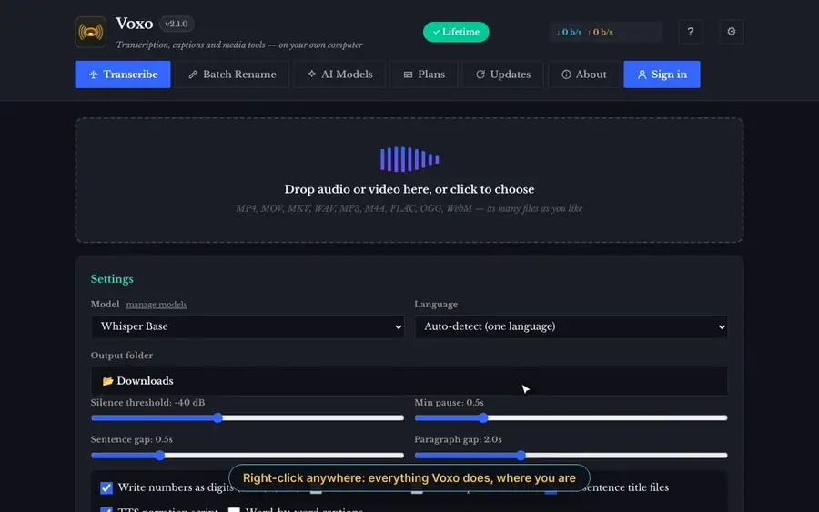

What you clicked first, then everything else — and eight layouts for your recent work. [Watch the MP4 with sound](demos/menus.mp4).

### Any window size

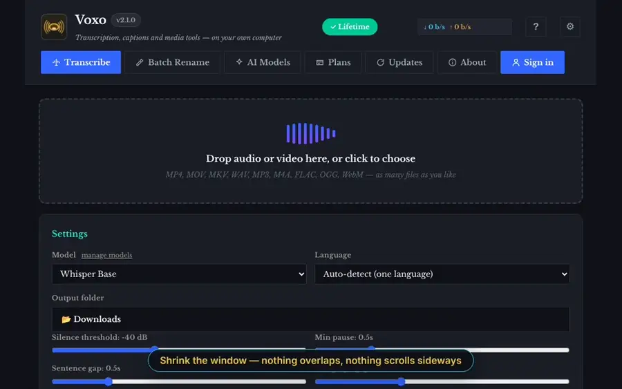

From 1600×1000 down to 420×260: nothing overlaps, nothing scrolls sideways. [Watch the MP4 with sound](demos/small-window.mp4).

### One account

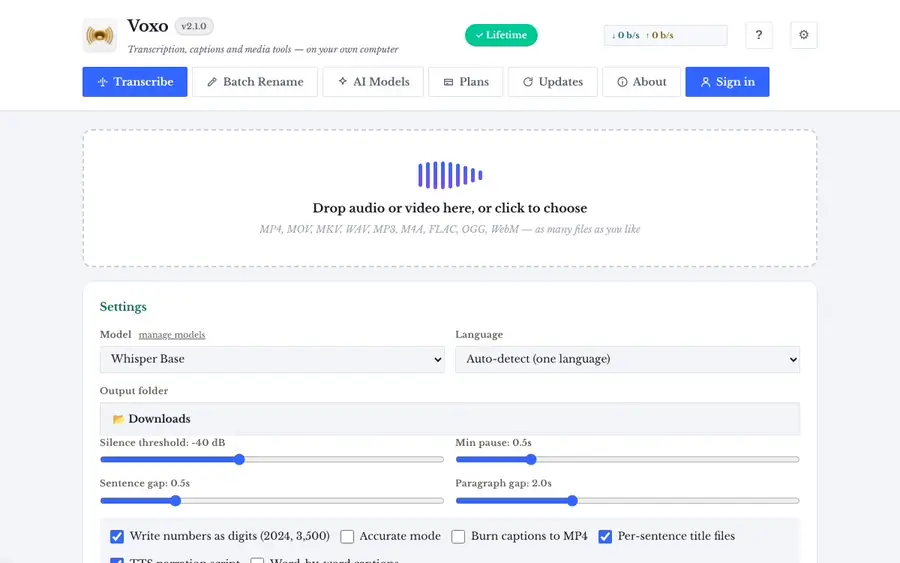

Sign in with an email code; seats, subscriptions and codes in one place. [Watch the MP4 with sound](demos/account.mp4).

### Menu-bar quick panel

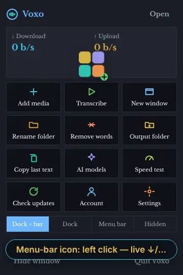

Live ↓/↑ speed, a speed test and one-click actions. [Watch the MP4 with sound](demos/quick-panel.mp4).

## Screenshots

### Transcribe

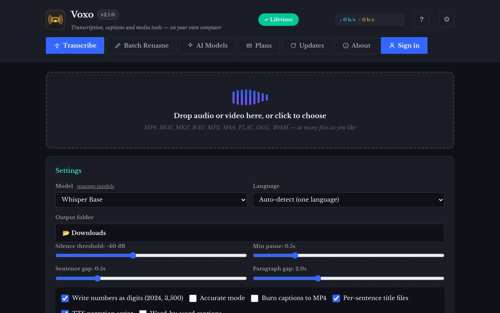

Drop audio or video and watch every step — pauses, language, model, transcription, numbers — with the percentage, time elapsed, time left and the clock time it will finish.

### Batch Rename — remove many words at once

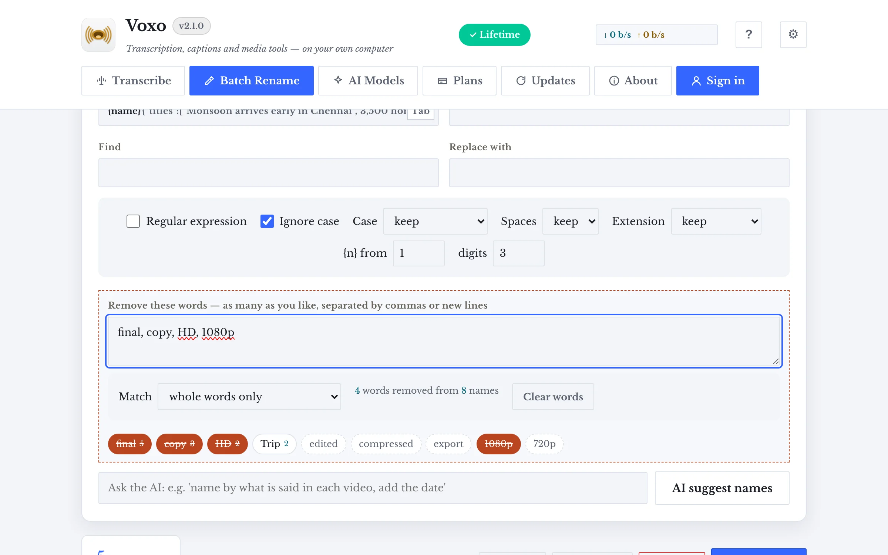

Type the words to remove, or click the chips Voxo finds in your file names; whole words or anywhere. Presets, templates, numbering and AI names too, with a live preview and one-click undo.

### AI Models

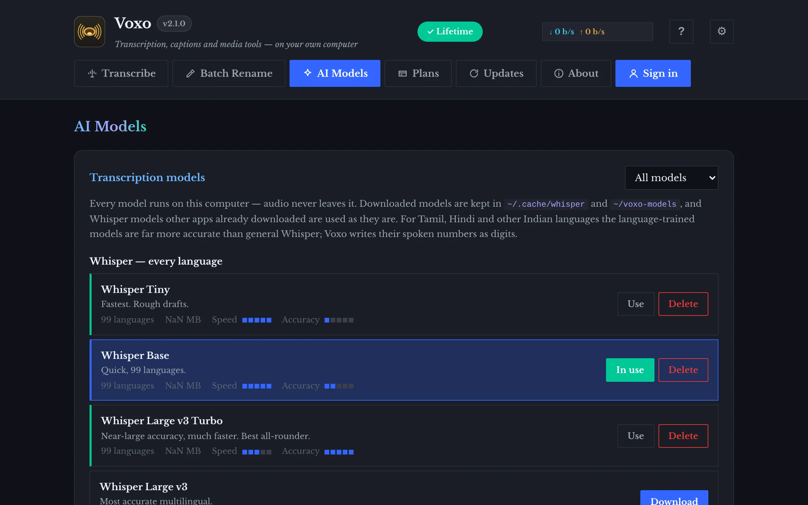

Whisper, Turbo, CrisperWhisper, models trained for Tamil, Hindi, Hinglish, Telugu, Kannada, Marathi and many world languages — plus Ollama models like Gemma, Qwen3, DeepSeek R1 and gpt-oss. The free built-in Voxo AI works for everyone.

### Account

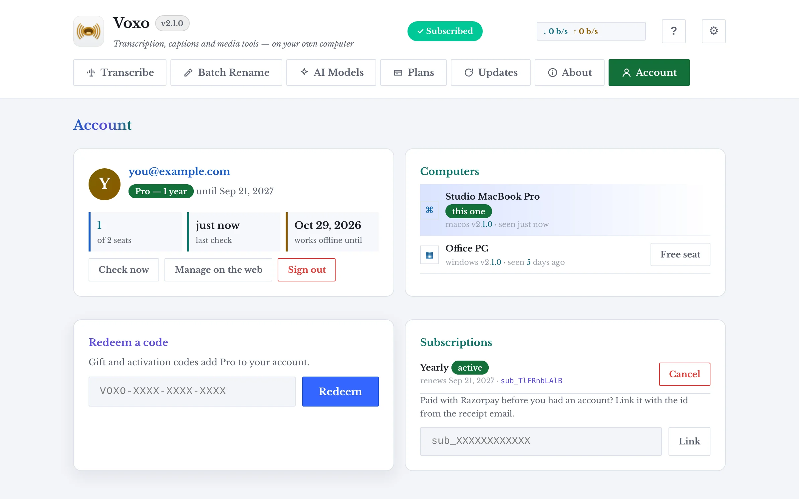

Sign in with an email code. Pro bought anywhere follows your account to two computers, works offline for 14 days, and you can free a seat from here.

### Right-click menus

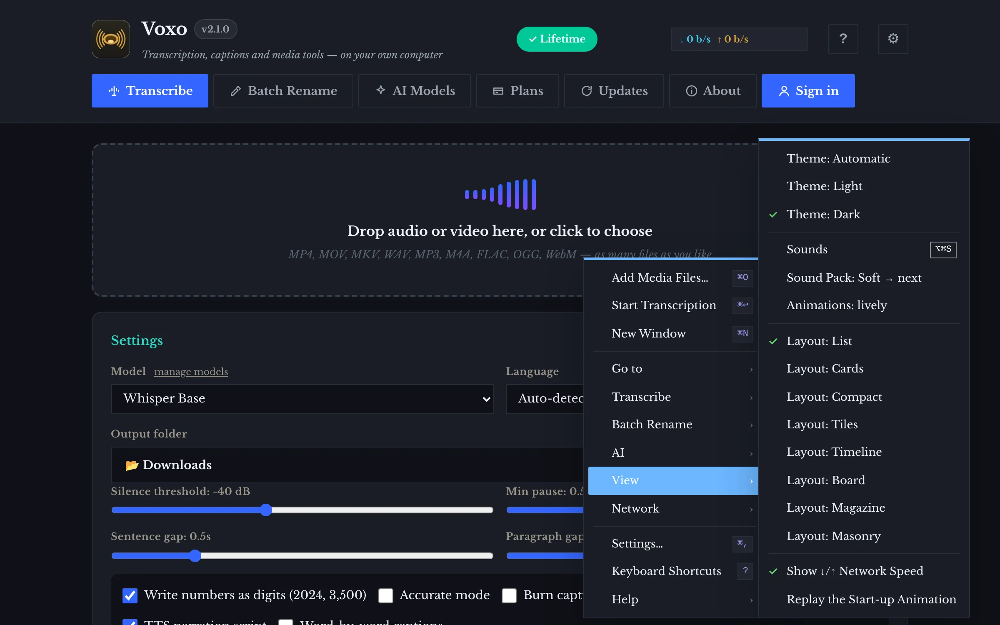

Right-click anywhere for what you clicked first, then everything Voxo does — themes, sounds, layouts, speed test, notifications.

### Menu-bar quick panel

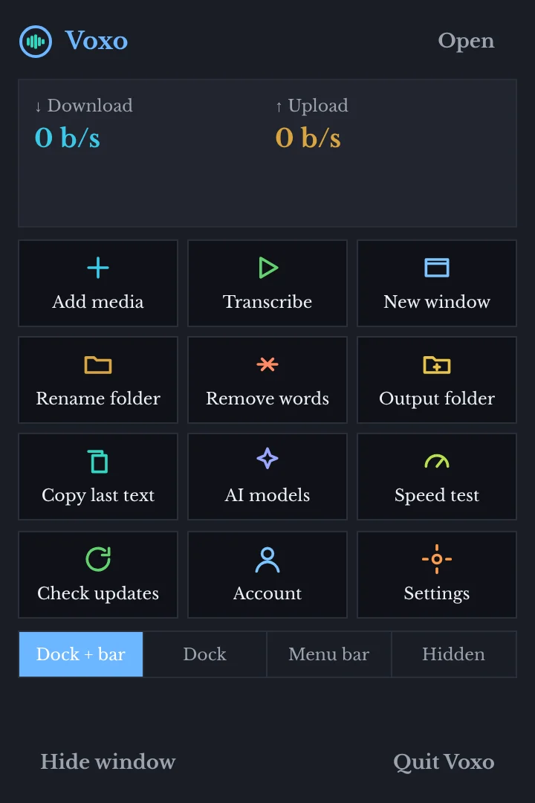

Left-click the menu-bar icon: live ↓/↑ network speed, a speed test and twelve one-click actions. Choose Dock + menu bar, Dock only, menu bar only or background.

### Settings

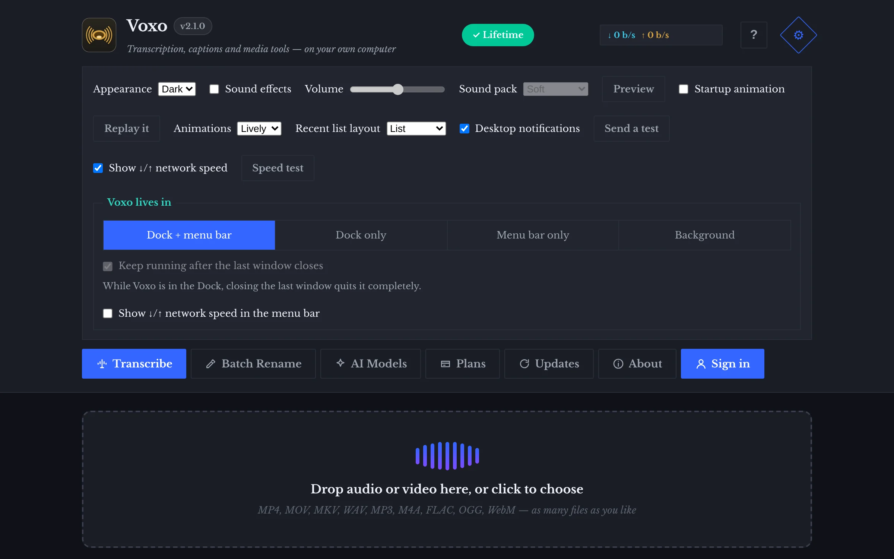

Sounds and ten sound packs, Off / Subtle / Lively animations, eight layouts, desktop notifications, network speed and where Voxo lives.

### Plans

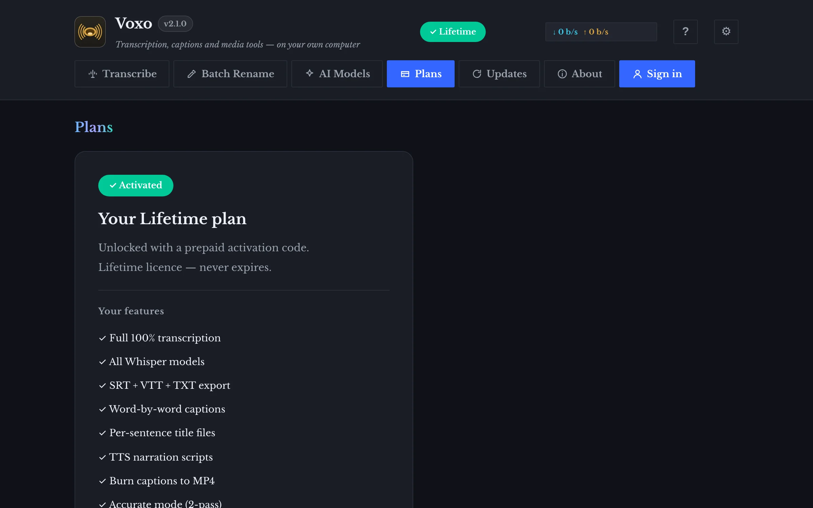

₹20 a month or ₹220 a year through Razorpay, or a monthly, yearly or lifetime activation code. Basic models and the free AI stay free for everyone.

### About

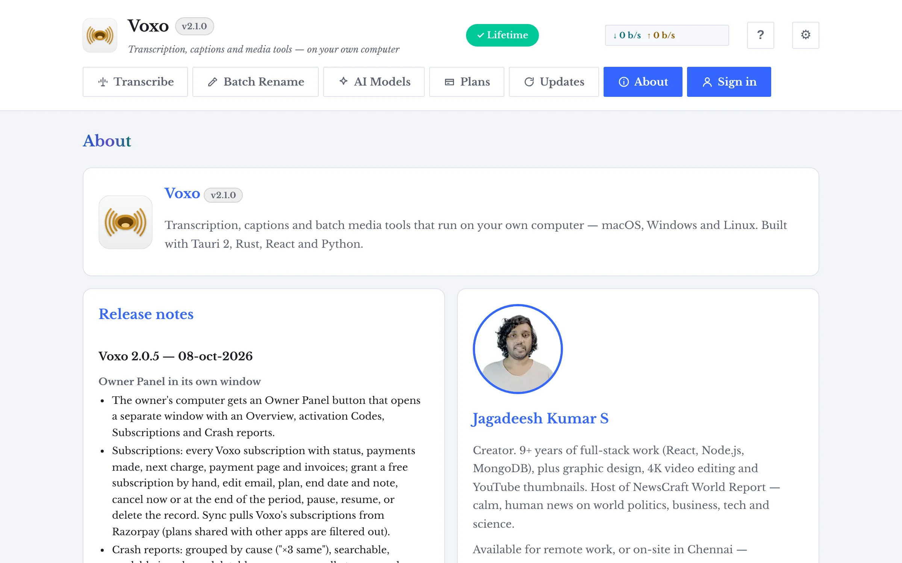

The app, its release notes, the licence and the creator in one place.

### Owner Panel

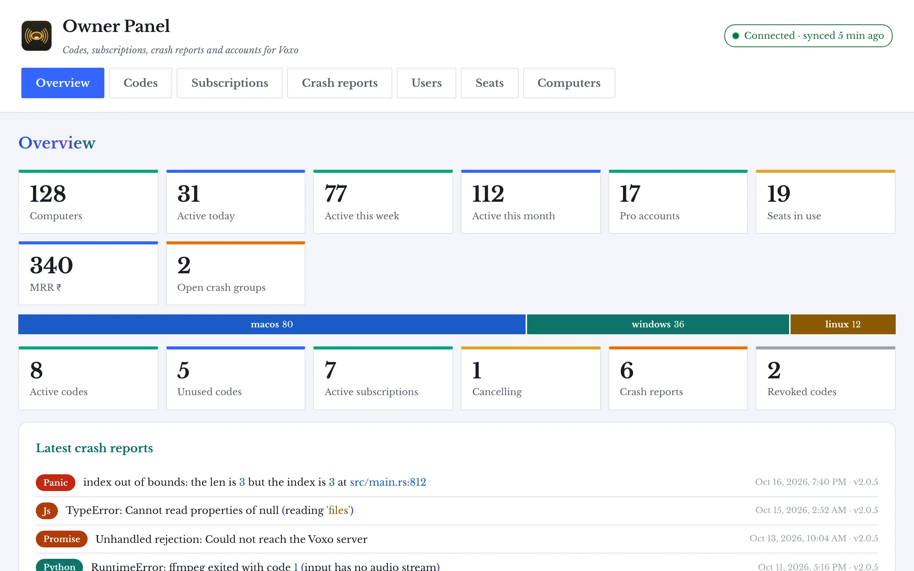

For the developer only, in its own window and always connected to the ipconfig dashboard: computers, active users, Pro accounts, MRR, codes, subscriptions and crash reports.

## Features

- **Local AI transcription** — Whisper Tiny to Large v3 and Large v3 Turbo, Distil-Whisper and CrisperWhisper for English, and one-language models for Tamil, Hindi (IIT Madras, IISc Vaani), Hinglish, Telugu, Kannada, Marathi, Gujarati, Malayalam, Bengali, plus German, French, Japanese, Chinese, Korean, Arabic, Russian, Turkish, Persian, Hebrew, Swedish, Norwegian, Finnish and Malay. Download, use and delete them in AI Models; models already on your computer are reused.
- **Numbers as digits** — spoken numbers become 2024, 3,500, 49 in English, Tamil and Hindi, with exact subtitle timing.
- **Progress you can read** — each step with percentage, time elapsed, time remaining and finish time, for one file or a whole batch; a desktop notification when a long job finishes (click it to come back).
- **Subtitles and scripts** — SRT, VTT, timestamped and plain TXT, word-by-word captions, per-sentence title files, TTS narration scripts, captions burned into MP4.
- **Batch rename for every file type** — files, folders or whole folder trees; templates, find and replace, **remove many words at once** (whole words or anywhere, with one-click chips), case, numbering, dates; live preview with clash checks and one-click undo.
- **AI assistant** — free built-in Voxo AI for everyone, or local models (Ollama — Gemma 3/4, Qwen3, DeepSeek R1, gpt-oss, Granite, Mistral, Phi-4, LFM 2.5 and more — and LM Studio), GitHub Models or any OpenAI-compatible URL.
- **Account** — sign in with an email code or password; Pro from the shop, a subscription or a code lives on your account, bound to each computer with a signed licence that works offline for 14 days. Free a seat from the app.
- **Menu bar, Dock and Finder** — choose Dock + menu bar, Dock only, menu bar only or background. Left-click the menu-bar icon for the quick panel, right-click for the full menu; the Dock icon has New Window, Add Media Files, Batch Rename, Recent Transcripts and more; Finder right-click offers Transcribe with Voxo, Batch Rename and Remove Words. Closing the last window quits Voxo whenever it is in the Dock.
- **Network speed** — live ↓ download / ↑ upload in the header, the quick panel and (optionally) the menu bar, plus a one-click speed test.
- **Right-click menus everywhere** and keyboard shortcuts (press **?**).
- **Looks after small windows** — from 420×260 up, nothing overlaps and nothing scrolls sideways.
- **Start-up animation, 63 sounds with a self-drawing picture each, ten sound packs**, Off / Subtle / Lively animations, eight layouts for recent work.
- **Colour that means one thing everywhere** — numbers, brackets, timestamps, files, errors and successes each have their own colour (no pink), light and dark.
- **Plans** — ₹20/month or ₹220/year with Razorpay, or monthly, yearly and lifetime activation codes.
- **Signed updates** from GitHub and Cloudflare R2, checked before they install.
- **Crash reports you control** — recorded on your computer and only sent if you press Send.
- **Owner Panel** (developer only, its own window, always connected to the ipconfig dashboard): activation codes, subscriptions, crash reports, users, seats and computers.

## What's new in 2.0.6

### One account for Pro bought anywhere
- New Sign in (Account once signed in) after About: sign in with a 6-digit email code or a
  password. Pro from the shop, a Razorpay subscription, a gift or activation code lives on
  your account and follows you to two computers (three with lifetime).
- Each computer gets an Ed25519-signed licence, checked inside Voxo every 12 hours and valid
  offline for 14 days. See your computers and free a seat, redeem codes, see and cancel
  subscriptions, and link an older subscription by its sub_ id.
- Bought before? Your old activation code or subscription moves to your account when you
  sign in, and keeps working until it ends either way.
- New subscriptions use the new ₹20/month and ₹220/year plans, and are put on your account when you are signed in.

### Menu bar, Dock, Finder and notifications
- Choose where Voxo lives: Dock and menu bar, Dock only, menu bar only, or in the background
  with no icon. Closing the last window quits Voxo whenever it is in the Dock; only menu-bar
  and background modes can keep running (and that can be switched off).
- Menu-bar icon: left click opens a quick panel with live ↓ download / ↑ upload speed, a
  speed test and twelve one-click actions; right click opens the full menu; double click shows
  the window. Optional live ↓/↑ speed next to the icon.
- Dock icon menu: New Window, Add Media Files, Transcribe in a New Window, Start / Cancel,
  Batch Rename, Remove Words, Recent Transcripts and every menu group.
- Finder right-click: Transcribe with Voxo, Transcribe in a New Voxo Window, Batch Rename with
  Voxo, Remove Words from Names with Voxo and Open in Voxo.
- Desktop notifications when a long transcription finishes or an update is found — click one
  to come straight back to Voxo. Turn them off or send a test in Settings.
- New Window (⌘N): several Voxo windows, each with its own queue.

### Batch Rename: remove many words at once
- Type any number of words or phrases (commas or new lines), match whole words or anywhere,
  and click the chips Voxo finds in your file names; separators left behind are tidied.

### More models
- 30 more transcription models: IISc Vaani Hindi, Telugu, Kannada and Bengali, Marathi,
  Hinglish (Oriserve), CrisperWhisper verbatim English, and strong single-language models for
  German, French, Japanese, Chinese, Korean, Arabic, Russian, Turkish, Persian, Hebrew, Swedish,
  Norwegian, Finnish and Malay. Large models split into several files now download and
  convert too.
- 24 suggested local assistant models for Ollama, from Gemma 3 1B to gpt-oss 20B, Qwen3,
  DeepSeek R1, Granite 4, Phi-4 mini, Gemma 4, LFM 2.5 and Mistral Small 3.2, with the memory
  each needs.

### Look, sound and small windows
- New start-up animation: the mark draws itself, sparks fly, the name rises in colour, the
  tagline types itself and "By Jagadeesh Kumar S" shines in — with its own sounds.
- Right-click menus everywhere, 63 sounds each with its own self-drawing picture, ten sound
  packs, Off / Subtle / Lively animations and eight layouts for recent transcriptions.
- Windows from 420×260 up: tabs shrink to short names and then icons; nothing overlaps and
  nothing scrolls sideways.

### Owner Panel
- Always connected to the ipconfig dashboard — no Connect or Sync buttons. Voxo says hello and
  pushes codes, subscriptions and crashes 20 seconds after start-up and every hour (the server
  does too), and the header shows "Connected · synced N min ago".
- New Users, Seats and Computers tabs with search, bulk actions and JSON export; the Overview
  adds computers, active users, Pro accounts and monthly revenue.

### Releases
- Every installer is built on the Mac — macOS (Apple silicon and Intel), Windows (x64 and
  ARM64), Linux (x64 and ARM64, .deb and AppImage) and FreeBSD 14. ChromeOS uses the Linux .deb.
  Haiku is not possible (Tauri has no Haiku WebView).
- Developer ID signing, Mac App Store and Microsoft Store builds run as soon as their keys are
  added to .env. The GitHub repositories carry 20 topics and the website link.
- Voxo is proprietary software; About → Licence shows the terms.

macOS: after installing, run `xattr -cr /Applications/Voxo.app` once.

<!-- licence -->
## Licence

Proprietary — © 2026 Jagadeesh Kumar S. All rights reserved. You may install and use Voxo; see LICENSE for the terms.
<!-- /licence -->

## Support

Questions: JKS.sys@icloud.com · Sponsor Voxo: https://razorpay.me/@NSBJKS · Website: https://ipconfig.co.network/voxo

Made by Jagadeesh Kumar S, creator — [youtube.com/@JKS-sys](https://youtube.com/@JKS-sys).

⭐ **If Voxo helps you, please star this repository** — it helps other people find it.
